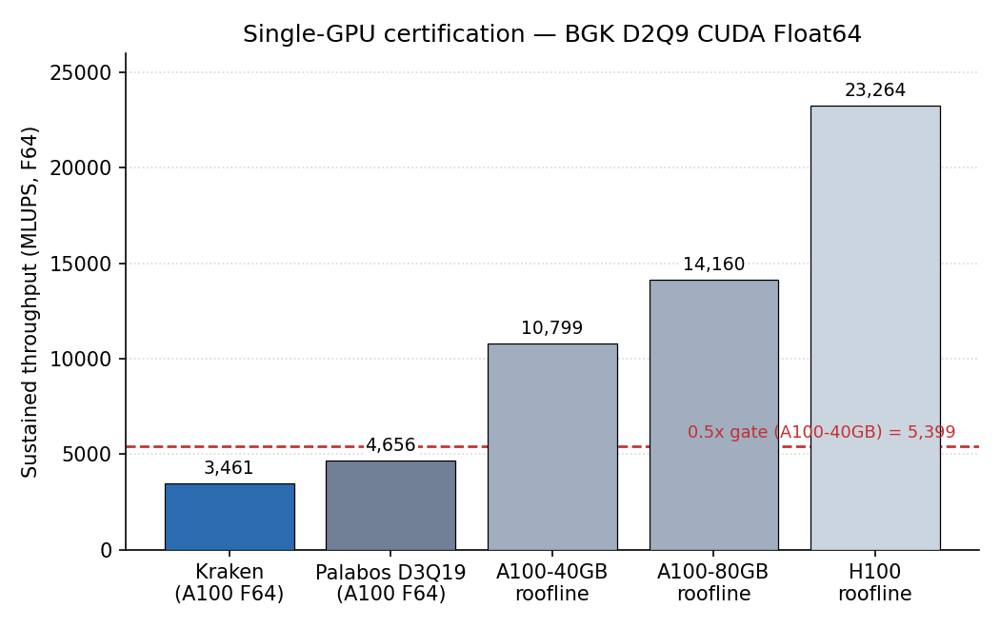

# GPU efficiency certification — BGK D2Q9 CUDA F64

Single-GPU throughput of the Newtonian BGK D2Q9 solver in **CUDA Float64** (Taylor–Green
driver, `run_taylor_green_2d`). Kraken sustains **3461 MLUPS** at `N = 2048` on an
**A100-40GB**. A D2Q9 Float64 update moves at least 144 bytes, so the bandwidth ceiling of
that GPU is 10 799 MLUPS and Kraken reaches **0.32** of it. That is **below** the
**≥ 0.5 of roofline** gate this page was written against.

A previous version of this page reported 0.68 and a PASS. It divided the bandwidth by
304 bytes per update, which is the D3Q19 traffic (2 × 19 × 8), not the D2Q9 traffic
(2 × 9 × 8 = 144). The measured 3461 MLUPS did not change; only the ceiling did.



## Result

Ceiling = peak bandwidth / 144 bytes. Ratio = 3461 / ceiling.

| Reference                          | MLUPS  | Kraken / ref | Type |
|------------------------------------|-------:|-------------:|------|
| A100-40GB roofline (1.555 TB/s)    | 10 799 | **0.32**     | bandwidth ceiling |
| A100-80GB roofline (2.039 TB/s)    | 14 160 | **0.24**     | bandwidth ceiling |
| Palabos, single-GPU F64 D3Q19 TRT  | 4656   | 0.74         | published real code, different lattice |

**Verdict: below the 0.5 gate** on the applicable A100-40GB ceiling (0.32). The Palabos
figure (about 73 % of A100 FP64 peak, Latt et al., *Comput. Math. Appl.* 2021; PASC '22)
is for D3Q19, which moves about twice the bytes per update of D2Q9, so the 0.74 ratio mixes
two lattices and is not a like-for-like efficiency. The H100 ceiling for D2Q9 would be
23 264 MLUPS (3.35 TB/s / 144 B); it is context only, the run was on an A100.

## Method

The metric is sustained MLUPS measured over 1000 steps after a discarded warm-up on an
`N × N` periodic domain:

```
MLUPS = N² · steps / wallclock_s / 1e6
```

Best sustained throughput was 3461 MLUPS at `N = 2048` (3084 MLUPS at `N = 1024`).

**Roofline.** LBM is memory-bandwidth bound: a D2Q9 BGK step in Float64 moves 9
populations in and 9 out, `2 × 9 × sizeof(Float64) = 144 bytes/update`, so the hard
upper bound is `MLUPS_ceiling = peak_BW / 144 / 1e6`. No F64 D2Q9 kernel can exceed it.

**Environment.** Aqua (QUT) node `gpu0n009`, NVIDIA A100-40GB (HBM2e, 1.555 TB/s peak),
CUDA Float64. The 40 GB roofline is the applicable ceiling; the 80 GB row is shown for
reference only (a larger ceiling, hence a smaller ratio).

## Caveats

- **GPU variant confirmed post-hoc via PBS node resources, not the run log.** The driver
  did not record the device; the A100-40GB identity was read from `pbsnodes gpu0n009`. A
  future tweak is to print `CUDA.versioninfo()` / `CUDA.device()` into the run log so the
  exact GPU and roofline are locked by the run itself.
- **Single-GPU, bandwidth-bound figure.** This certifies single-GPU throughput against
  the memory roofline; it is not a multi-GPU or weak/strong-scaling result.

## Reproduce

```bash
# Aqua (CUDA F64) — runs the certification sweep and writes the CSV:
julia --project=. bench/certification/cavity_bgk_cuda/run_certification.jl

# regenerate the figure:
conda run -n kraken-v0-3-figures python bench/certification/plot_certification.py
```

Data: `benchmarks/results/certification_a100.csv`. Reference derivation:
`bench/certification/E1_REFERENCE.md`. F32 codes such as FluidX3D (Lehmann,
arXiv:2112.08926) are **not** comparable to this F64 gate — single precision moves half
the bytes per update.
